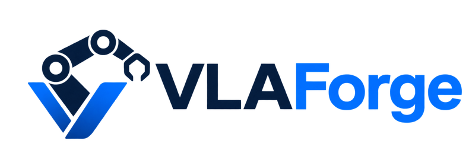

# VLAForge

[](docs/installation.md)
[](pyproject.toml)
[](LICENSE)
[](docs/website.md)
[](.github/workflows/ci.yml)



VLAForge is a modular Python framework for building Vision-Language-Action
models. It provides shared interfaces and data structures so model, dataset,
training, and inference implementations can evolve independently.

The project is at an early development stage. It currently provides core model
contracts, a basic custom data pipeline, an injected-encoder VLA model, a
generic trainer, checkpoint-based inference, and offline action metrics.
Applications supply their own encoder modules and tokenizer; built-in
Hugging Face backbone integrations are not included.

## Custom dataset format

Pass either a directory containing `manifest.jsonl` or the manifest path to
`CustomVLADataset`. Each non-empty line is a JSON object with an instruction,
one or more image paths relative to the manifest, and an action vector:

```json
{"image": "images/frame_0001.png", "instruction": "pick up the cube", "action": [0.1, 0.2, 0.3, 0.0, 0.0, 0.0, 1.0], "episode_id": "episode_1"}
```

For multiple cameras, use an `images` object keyed by camera name instead of
`image`. The dataset requires an `ActionSpec`; compute normalization statistics
from the training split only. Inject a tokenizer matching the chosen language
model into `VLACollator`.

## First model architecture

`VLAActionModel` combines injected vision and language encoder modules with a
small MLP action head. The encoders must return pooled feature vectors or
token/spatial features, and the language encoder must accept `input_ids` and
`attention_mask`. This keeps pretrained model choices optional and avoids
implicit downloads. Pass a matching tokenizer when constructing the model to
enable single-observation `predict_action`; use `VLAActionConfig` to set encoder
feature sizes, action dimensions, and encoder freezing behavior.

## Training

The generic `Trainer` calls the model's `compute_loss` method and does not
contain architecture-specific logic. For `VLAActionModel`, a tokenizer must be
provided so the trainer can infer its collator. Other `BaseVLA` implementations
can pass a custom collator:

```python
from vlaforge.models import VLAActionModel
from vlaforge.training import Trainer

trainer = Trainer(
    model=model,
    train_dataset=train_dataset,
    val_dataset=validation_dataset,
    config="configs/training/default.yaml",
)
history = trainer.train()
```

The trainer writes resumable `checkpoint_last` weights and training state to
the configured output directory. When validation is enabled, it can also keep
`checkpoint_best`. Resume by passing a checkpoint directory as `resume_from`.
The model architecture and its encoders still need to be constructed by the
application before resuming.

If actions are normalized, use the same `ActionNormalizer` in your collator
(`action_transform=normalizer.normalize`) and pass it to `Trainer`. Its
statistics will be saved in each checkpoint and automatically loaded by
`InferencePipeline`.

## Inference and evaluation

`VLAActionModel.save_pretrained()` stores its configuration and Safetensors
weights. Reload it with `VLAActionModel.from_pretrained()`, supplying the same
encoder architectures and tokenizer; the checkpoint restores their trained
weights. `InferencePipeline` and `Evaluator` can then be used without importing
the training package. Evaluation reports MSE, MAE, and RMSE over action values.
Metrics use the data values as provided by the collator; pass the training
`ActionNormalizer` and select `metric_space="physical"` to report original
action units.

The synthetic workflow in `examples/synthetic_vla_workflow.py` demonstrates
training, checkpoint reload, action prediction, and evaluation without
downloading pretrained models or datasets.

## Installation

See the [installation guide](docs/installation.md) for requirements and setup
instructions, including CPU, CUDA, Kaggle, and Windows environments. The
[API guide](docs/api.md) documents public interfaces and tensor shapes.

## Quick-start example

Run the synthetic workflow to exercise training, checkpoint reload, inference,
and evaluation without external model weights or datasets:

```bash
python examples/synthetic_vla_workflow.py
```

More walkthroughs are in [Getting started](docs/getting_started.md) and the
[training](docs/training.md) and [inference](docs/inference.md) guides.

See the [dataset guide](docs/datasets.md) and [public API reference](docs/api.md)
for more detail. The [documentation site guide](docs/website.md) explains how
the user guides are organized.

## License

VLAForge is licensed under the [MIT License](LICENSE).
