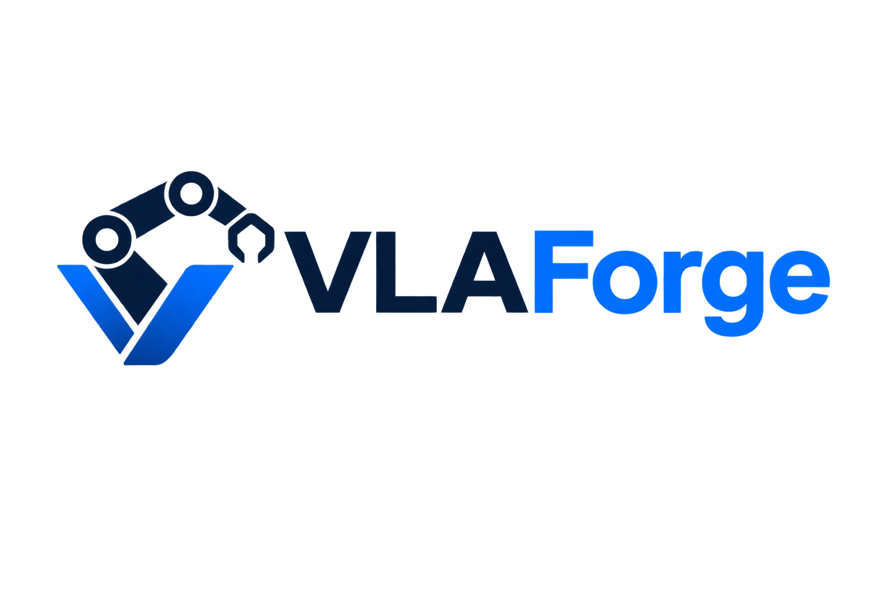

# VLAForge

VLAForge is a modular Python framework for building Vision-Language-Action
models. It provides shared interfaces and data structures so model, dataset,
training, and inference implementations can evolve independently.

The current release foundation includes a custom dataset pipeline, an
injected-encoder VLA action model, a generic PyTorch trainer, checkpoint-based
inference, and offline action metrics. Specific pretrained encoders and their
tokenizers are supplied by applications; VLAForge does not download them
automatically.

## Explore the documentation

- [Getting started](getting_started.md)
- [Installation](installation.md)
- [Dataset format and preprocessing](datasets.md)
- [Training and checkpoints](training.md)
- [Inference and evaluation](inference.md)
- [Public API reference](api.md)
- [Contributing](contributing.md)

Try the [synthetic workflow](getting_started.md) to train, reload, predict, and
evaluate without external datasets or pretrained model downloads.
